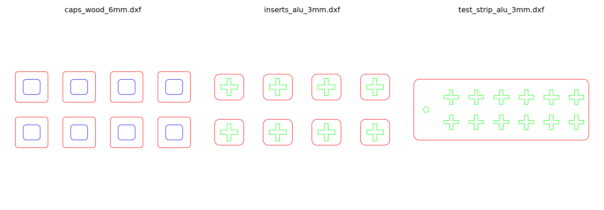

# Wooden Choc V2 keycaps (hidden aluminium stem insert)

All files are in mm. The layer names say what to do with each shape.

| File | Material | Layers |
|---|---|---|
| `test_strip_alu_3mm.dxf` | 3 mm aluminium | `CROSS_THRU` (1 mm bit, through), `OUTLINE_THRU` (through, tabs) |
| `inserts_alu_3mm.dxf` | 3 mm aluminium | same |
| `caps_wood_6mm.dxf` | 6 mm ply | `POCKET_3mm` (pocket, ≤3.175 mm bit), `OUTLINE_THRU` (through, tabs) |

## Order

1. **Test strip.** Cut it and press it onto a switch.
   - The marker hole is the small end. Going left to right, the slot width offsets are −0.06, −0.03, 0, +0.03, +0.06, +0.09 mm.
   - The top row is the normal orientation and the bottom row is rotated 90°.
   - Pick the tightest hole that still slides on.
2. **Inserts.** Regenerate them with the offset you picked, then cut:
   `python3 make_dxf.py --offset 0.03`
   If only the bottom (rotated) row fit, swap `H_SLOT_W` and `V_SLOT_W` in the script.
3. **Caps.** Lay the ply good face **down**.
   - Measure the real aluminium thickness and use that as the pocket depth.
   - Cut the pockets, then the outlines with tabs.
4. **Assemble.** Scuff each insert, epoxy it in flush, and deburr the cross.
   Check full key travel on one cap before gluing the rest.

## Aluminium cutting

- Use a 1 mm single-flute bit with lubricant (WD-40).
- Take about 0.1 mm per pass, with a spoilboard underneath.
- Cut the crosses first, then the outlines.
- Each cross arm is extended by half the tool diameter, so the round bit clears the square stem ends.

The stem sizes are the MX nominal values that Choc V2 uses. The test strip is there because they are approximate.
